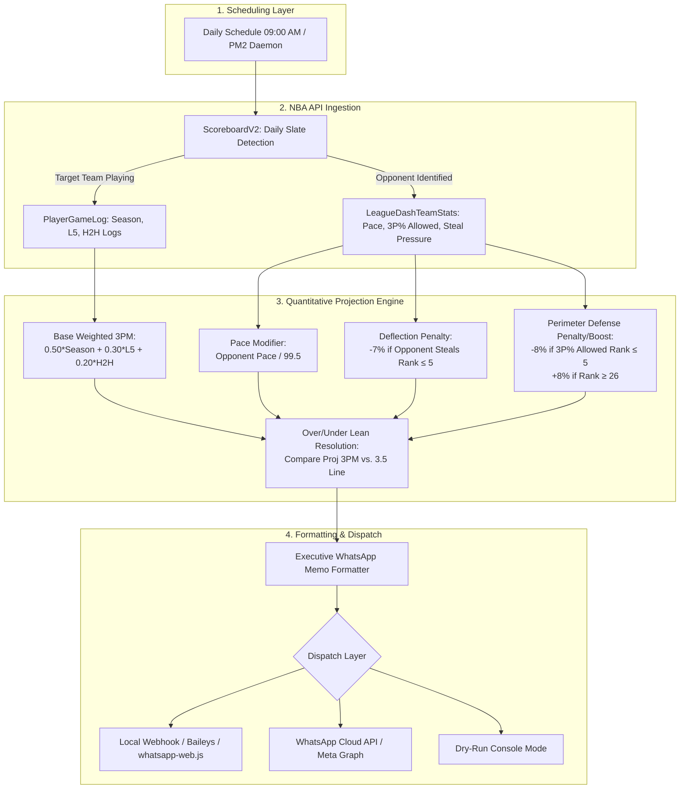

# AnalyticsBot: Automated NBA 3P Prop Intel & Notification Bot

**AnalyticsBot** is a high-performance Python analytics and notification bot designed to monitor upcoming NBA games for 4 high-volume 3-point shooters, compute quantitative 3-pointers made (3PM) projections using weighted empirical parameters and defensive context modifiers, and automatically dispatch executive sports betting intel memos directly to a personal WhatsApp endpoint.

---

## 🎯 Monitored Target Players

Configured in `config.py` with official NBA API player and team identifiers:

| Player | NBA API ID | Team | Consensus 3PM Line |
| :--- | :--- | :--- | :--- |
| **Stephen Curry** | `201939` | **GSW** (Golden State Warriors) | 3.5 3PM |
| **Luka Dončić** | `1629029` | **DAL** (Dallas Mavericks) | 3.5 3PM |
| **LaMelo Ball** | `1630163` | **CHA** (Charlotte Hornets) | 3.5 3PM |
| **Donovan Mitchell** | `1628378` | **CLE** (Cleveland Cavaliers) | 3.5 3PM |

---

## 🏛️ System Architecture



---

## 📐 Projection Engine Logic & Formula

### 1. Base Weighted 3PM
$$\text{Weighted 3PM} = (0.50 \times \text{Season Avg 3PM}) + (0.30 \times \text{Last 5 Avg 3PM}) + (0.20 \times \text{H2H Avg 3PM})$$
- *H2H Fallback*: If head-to-head games against today's opponent equal zero, the engine gracefully falls back to the season baseline.

### 2. Matchup Modifiers
- **Pace Adjustment**:
  $$\text{Pace Multiplier} = \frac{\text{Opponent Pace}}{99.5\text{ (League Average Pace)}}$$
  Scales expected attempts and base 3PM proportionally to projected game tempo.
- **Steal / Deflection Penalty**:
  If the opponent ranks in the **Top 5** in steals per game (rank $\le 5$), reduces expected 3PM by **7%** (`-0.07`), penalizing shooters vulnerable to on-ball ball-screen disruption (e.g. LaMelo Ball).
- **Perimeter Defense Penalty / Boost**:
  - If opponent ranks in the **Top 5** in lowest 3P% allowed (rank $\le 5$), applies an **8% penalty** (`-0.08`).
  - If opponent ranks in the **Bottom 5** (rank $\ge 26$, porous perimeter defense), applies an **8% boost** (`+0.08`).

### 3. Actionable Lean
$$\text{Lean} = \begin{cases} \text{OVER 3.5} & \text{if } \text{Projected 3PM} > 3.5 \\ \text{UNDER 3.5} & \text{if } \text{Projected 3PM} < 3.5 \\ \text{PUSH 3.5} & \text{if } \text{Projected 3PM} = 3.5 \end{cases}$$

---

## 📱 WhatsApp Memo Format

Every generated alert matches the following layout:

```text
🏀 NBA 3P PROP INTEL | TONIGHT'S SLATE

Player: Stephen Curry (GSW vs. LAL)
Consensus Line: 3.5 3PM (O/U)

🎯 Model Projection: 6.1 3PM (Lean: OVER 3.5)

📊 Statistical Breakdown:
• Season Baseline: 5.5 3PM on 12.9 attempts (42.7%)
• Recent Form (Last 5): 5.2 3PM on 11.0 attempts
• Head-to-Head History: 6.0 3PM over last 4 meetings

🛡️ Opponent Matchup Factors:
• Opponent Pace: Ranked #6 (Fast matchup pace)
• Perimeter Defense: Ranked #27 in 3P% allowed (37.6%)
• Steal Threat: Ranked #16 (Moderate perimeter disruption)

Verdict: Projected 6.1 3PM clears the 3.5 line by +2.6 makes, underpinned by an elevated matchup pace (+1.9% expected possessions), combined with a favorable matchup against LAL's porous perimeter defense (ranked #27 in 3P% allowed), combined with dominant historical success vs LAL (6.0 3PM avg). Strong value on the OVER.
```

---

## 🚀 Setup & Installation

### 1. Requirements
- Python 3.10+
- Internet connection for official stats from `stats.nba.com`
- Node.js & PM2 (optional, for persistent background daemon)

### 2. Install Dependencies
```bash
pip install -r requirements.txt
```

### 3. Configure Environment Variables
Copy `.env.example` to `.env` and configure your credentials:
```bash
cp .env.example .env
```

Key environment options:
```env
# Dispatch Mode: 'callmebot' (easiest free), 'waha' / 'webhook' (self-hosted), 'cloud' (official), or 'console'
WHATSAPP_DISPATCH_MODE=callmebot

# --- Option A: CallMeBot (100% Free, No Meta API required) ---
CALLMEBOT_API_KEY=your_api_key_here

# --- Option B: WAHA / Self-Hosted Webhook on VM ---
WHATSAPP_WEBHOOK_URL=http://localhost:3000/api/sendText

# Target recipient phone number (E.164 format)
WHATSAPP_RECIPIENT_PHONE=+1234567890

# Daily schedule time (24h format, default 09:00 AM)
SCHEDULE_TIME=09:00
```

---

## 🧪 Testing & Execution

### 1. Run Unit Tests
Run the 10-test automated suite verifying formulas, fallbacks, modifiers, and formatters:
```bash
python -m unittest test_analytics_bot.py -v
```

### 2. Immediate Dry Run (Simulated / Mock Data)
Test the entire pipeline offline with sample fixtures without calling external APIs:
```bash
python bot.py --run-now --mock --dry-run
```

### 3. Run Live Slate Analysis for Today
Query today's actual live games and print results:
```bash
python bot.py --run-now --dry-run
```

### 4. Backtest a Specific Date Slate
Evaluate any historical NBA date:
```bash
python bot.py --run-now --date 2024-10-25 --dry-run
```

---

## 🔄 Keeping Alive via PM2

AnalyticsBot is engineered to run as a continuous background daemon managed by **PM2**.

### Option A: Direct PM2 CLI
```bash
pm2 start bot.py --name "analytics-bot" --interpreter python -- --daemon
```

### Option B: PM2 Ecosystem File
Launch using the included `ecosystem.config.js`:
```bash
pm2 start ecosystem.config.js
```

### Useful PM2 Commands
```bash
# View real-time logs
pm2 logs analytics-bot

# Monitor status and memory usage
pm2 status

# Restart or stop the bot
pm2 restart analytics-bot
pm2 stop analytics-bot
```

---

## ☁️ Running on Oracle Cloud Always Free (24/7 Hosting)

Oracle Cloud Infrastructure (OCI) offers an **Always Free Tier** with free Compute VMs (e.g. Ubuntu Ampere A1 or AMD E2.1.Micro) that never expire and require \$0.

### Step-by-Step OCI Setup:
1. **Create an Always Free Instance**:
   - Go to Oracle Cloud Console &rarr; **Instances** &rarr; **Create Instance**.
   - Image: **Ubuntu 22.04 LTS** (or 24.04).
   - Shape: **Always Free Eligible** (AMD VM.Standard.E2.1.Micro or Ampere A1).
   - Save your SSH private key (`ssh-key.key`).
2. **SSH into your VM**:
   ```bash
   ssh -i /path/to/ssh-key.key ubuntu@<YOUR-VM-PUBLIC-IP>
   ```
3. **Install Dependencies**:
   ```bash
   sudo apt update && sudo apt install -y python3-pip python3-venv git nodejs npm
   sudo npm install -g pm2
   ```
4. **Clone and Configure**:
   ```bash
   git clone <YOUR-PERSONAL-GITHUB-REPO-URL>
   cd "Analytics Bot"
   pip install -r requirements.txt
   cp .env.example .env
   nano .env  # set WHATSAPP_DISPATCH_MODE and your credentials
   ```
5. **Start with PM2 Daemon**:
   ```bash
   pm2 start bot.py --name "analytics-bot" --interpreter python3 -- --daemon
   pm2 save
   pm2 startup
   ```

---

## 📁 Project Structure

```
Analytics Bot/
├── bot.py                  # Main coordinator, CLI runner, and PM2 scheduler daemon
├── config.py               # Monitored players, model weights, and API configuration
├── dispatcher.py           # Pluggable WhatsApp sender (Webhook, Cloud API, Console)
├── formatter.py            # WhatsApp executive memo layout formatter
├── nba_client.py           # nba_api endpoints (ScoreboardV2, GameLogs, TeamDefense)
├── test_analytics_bot.py   # Unit test suite for math, modifiers, formatting, and dispatch
├── ecosystem.config.js     # Production PM2 process configuration
├── requirements.txt        # Python dependency manifest
├── .env.example            # Environment variables template
└── README.md               # Complete architecture and usage documentation
```
